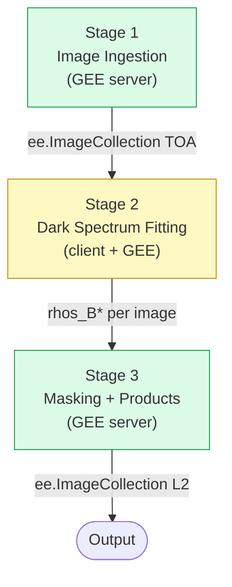
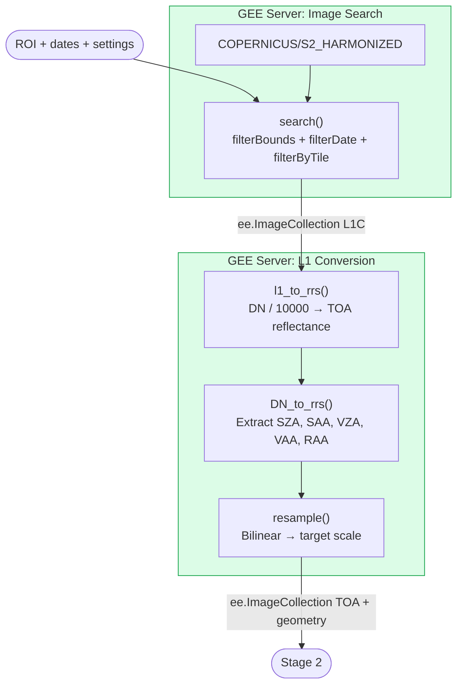
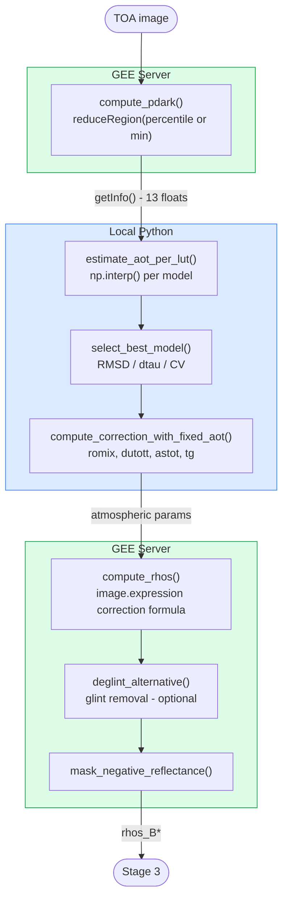
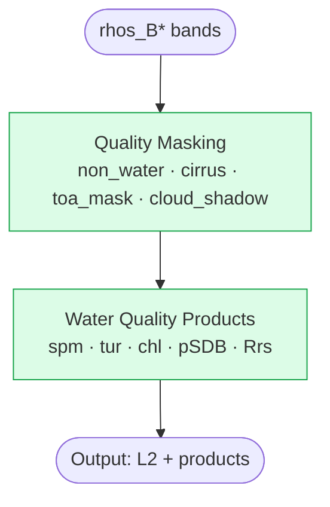
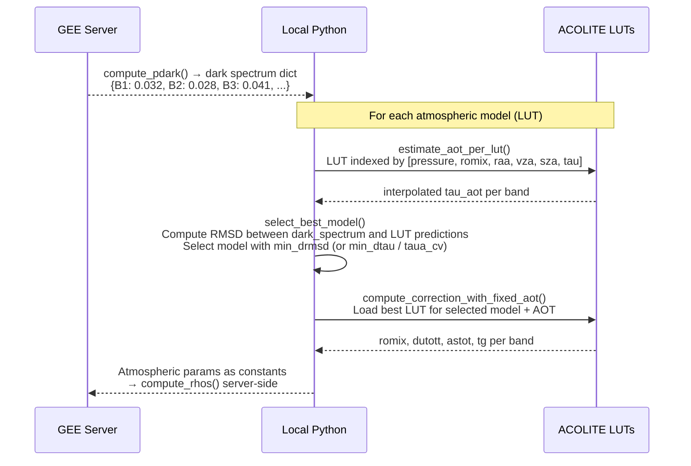

# Data Flow

Complete data flow through GEE ACOLITE, from raw Sentinel-2 L1C imagery to atmospheric correction and derived products.

The critical architectural feature is the **hybrid client/server model**: image processing runs on GEE servers, while AOT estimation runs locally using ACOLITE's LUTs and numpy/scipy. The only synchronous data transfer per image is a single `getInfo()` call that retrieves the dark spectrum.

---

## Pipeline Overview

Three sequential stages, each described in detail below.

---

## Stage 1 — Image Ingestion

Search the Sentinel-2 catalog and convert DN to TOA reflectance. Entirely server-side.

---

## Stage 2 — Dark Spectrum Fitting (per image)

The only stage with client-server data transfer. Repeated once per image.

---

## Stage 3 — Quality Masking & Products

Apply combined quality mask and compute water quality products. Entirely server-side.

---

## Client vs Server Breakdown

### Server-Side Operations (GEE Cloud)

All operations that return `ee.Image` or `ee.ImageCollection` without calling `.getInfo()` are lazy and executed on GEE servers:

| Operation | Function | GEE primitive |
|-----------|----------|---------------|
| Image catalog search | `search()` | `filterBounds`, `filterDate`, `filter` |
| DN → TOA conversion | `DN_to_rrs()` | `image.divide(10000)` |
| Geometry extraction | `get_mean_band_angle()` | `image.get()`, `ee.Number` |
| Resampling | `resample()` | `resample('bilinear')`, `reproject()` |
| Dark spectrum extraction | `compute_pdark()` | `reduceRegion()` → **`getInfo()`** |
| Surface reflectance | `compute_rhos()` | `image.expression()` |
| Negative mask | `mask_negative_reflectance()` | `updateMask(image.gte(0))` |
| Water mask | `non_water()` | `B11.lt(threshold)` |
| Cirrus mask | `cirrus_mask()` | `B10.lt(threshold)` |
| Cloud mask | `toa_mask()` | `band.lt(threshold)` |
| Cloud shadow | `add_cld_shdw_mask()` | `directionalDistanceTransform`, `focal_min/max` |
| Water quality products | `spm_nechad2016*`, `chl_oc3`, etc. | `image.expression()`, `normalizedDifference()` |
| pSDB | `pSDB_green()`, `pSDB_red()` | `log()` expressions |
| Rrs | `rrs()` | `image.divide(pi)` |
| Bathymetry mosaic | `multi_image()` | `qualityMosaic()` |
| SDB calibration | `calibrate_sdb()` | `sampleRegions()`, `Reducer.linearFit()` |
| Glint correction | `deglint_alternative()` | `image.subtract()`, `updateMask()` |

### Client-Side Operations (Local Python)

Only these operations run locally and block execution until complete:

| Operation | Function | Library |
|-----------|----------|---------|
| Settings parsing | `__load_settings()` | ACOLITE |
| LUT loading | `select_lut()` | `acolite.aerlut.import_luts()` |
| Gas transmittance | `select_lut()` | `acolite.ac.gas_transmittance()` |
| **Dark spectrum retrieval** | `compute_pdark()` → `.getInfo()` | `earthengine-api` |
| AOT estimation per LUT | `estimate_aot_per_lut()` | `numpy.interp()` |
| Best model selection | `select_best_model()` | `numpy`, `scipy` |
| Ancillary data fetch | `get_ancillary_data()` | `acolite.ac.ancillary.get()` |
| DSF orchestration | `dask_spectrum_fitting()` | Python |
| SDB calibration readout | `calibrate_sdb()` → `.getInfo()` | `earthengine-api` |

!!! warning "Performance bottleneck"
    The only synchronous `getInfo()` call per image is in `compute_pdark()`. All other GEE operations are lazy and batched. This means **processing time scales linearly with number of images** (one `getInfo` per image).

---

## AOT Estimation Detail

The core of the hybrid workflow — how a single global AOT is estimated from the image:

---

## Data Transformation by Stage

### Stage 1 — L1C Input

| Property | Value |
|----------|-------|
| Format | `ee.ImageCollection` |
| Band values | Digital Numbers (DN), 0–10000 |
| Bands | B1–B12 (13 bands) |
| Resolution | 10m / 20m / 60m (native) |
| Source | `COPERNICUS/S2_HARMONIZED` |

### Stage 2 — TOA Reflectance

| Property | Value |
|----------|-------|
| Band values | TOA reflectance (DN / 10000), 0–1 |
| New bands | `sza`, `saa`, `vza`, `vaa`, `raa` (geometry angles) |
| Resolution | All resampled to `s2_target_res` |

**Geometry extraction:**

| Angle | Source metadata property |
|-------|--------------------------|
| Solar zenith (SZA) | `MEAN_SOLAR_ZENITH_ANGLE` |
| Solar azimuth (SAA) | `MEAN_SOLAR_AZIMUTH_ANGLE` |
| View zenith (VZA) | Mean of `MEAN_INCIDENCE_ZENITH_ANGLE_B*` (13 bands) |
| View azimuth (VAA) | Mean of `MEAN_INCIDENCE_AZIMUTH_ANGLE_B*` (13 bands) |
| Relative azimuth (RAA) | `|SAA - VAA|`, clamped to [0°, 180°] |

### Stage 3 — Surface Reflectance (L2)

The atmospheric correction formula applied per band:

$$
\rho_s(\lambda) = \frac{\rho_{TOA}(\lambda) / t_g(\lambda) - \rho_{mix}(\lambda)}{T_{up}(\lambda) + A_{sph}(\lambda) \cdot (\rho_{TOA}(\lambda) / t_g(\lambda) - \rho_{mix}(\lambda))}
$$

Where:

| Symbol | Parameter | Source |
|--------|-----------|--------|
| $\rho_{TOA}$ | Top-of-atmosphere reflectance | GEE (Stage 2) |
| $t_g$ | Gas transmittance | ACOLITE LUT (client) |
| $\rho_{mix}$ | Path reflectance (`romix`) | ACOLITE LUT (client) |
| $T_{up}$ | Total upward transmittance (`dutott`) | ACOLITE LUT (client) |
| $A_{sph}$ | Spherical albedo (`astot`) | ACOLITE LUT (client) |

**Output bands:** `rhot_B*` (TOA preserved) + `rhos_B*` (surface reflectance)

### Stage 4 — Water Quality Products

| Product | Formula | Output |
|---------|---------|--------|
| SPM Nechad | `A * rhos / (1 - rhos/C)` | mg/L |
| Turbidity Nechad | `A * rhos / (1 - rhos/C)` | FNU |
| Chl-a OC2 | `10^poly(log10(B2/B3))` | mg/m³ |
| Chl-a OC3 | `10^poly(log10(max(B1,B2)/B3))` | mg/m³ |
| Chl-a NDCI | `a + b*NDCI + c*NDCI²` | mg/m³ |
| pSDB green | `log(1000π·B2) / log(1000π·B3)` | dimensionless |
| pSDB red | `log(1000π·B2) / log(1000π·B4)` | dimensionless |
| Rrs | `rhos / π` | sr⁻¹ |

---

## Band Naming Convention

| Prefix | Meaning | Example |
|--------|---------|---------|
| `rhot_` | TOA reflectance (DN/10000) | `rhot_B2` |
| `rhos_` | Surface reflectance (L2) | `rhos_B3` |
| `Rrs_` | Remote sensing reflectance (rhos/pi) | `Rrs_B4` |
| product name | Derived product | `spm_nechad2016`, `chl_oc3` |

---

## References

- [Class Diagram](class_diagram.md)
- [GEE Integration](gee_integration.md)
- [Configuration](../guide/configuration.md)
